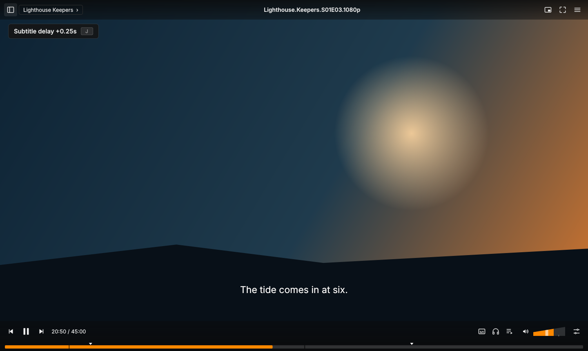
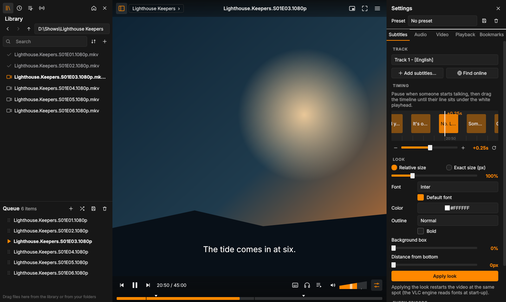
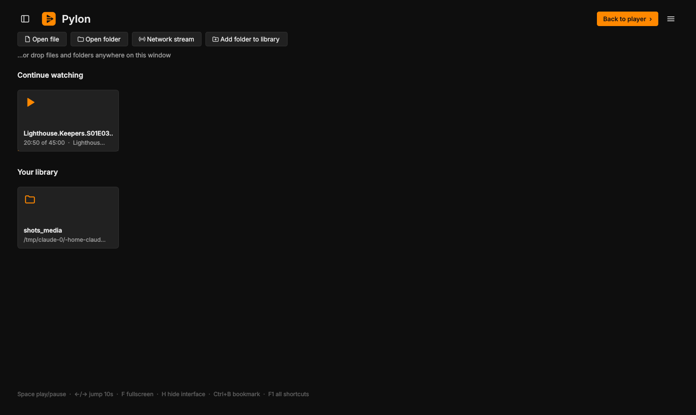

# Pylon

**A calmer, redesigned interface for the VLC engine on Windows.**

Pylon puts a new interface on top of libVLC, the engine inside VLC media player. VLC still does all the playback, decoding, subtitles and streaming, so Pylon plays everything VLC plays. The interface is built around the way people actually watch: quiet bars that get out of the way, a thick seek bar, subtitle timing you can see, per-show presets, and a library and queue you can reach without leaving the video.

> **Beta.** Pylon works on Windows 10 and 11 but has only been tested on a few PCs. Bug reports are very welcome.





## Credit

The interface follows the **VLC redesign concept by [Juxtopposed](https://www.youtube.com/@juxtopposed)**:

* Video: [the VLC redesign walkthrough](https://www.youtube.com/watch?v=ERFeOgqk324)
* Design file: [VLC redesign on Figma Community](https://www.figma.com/community/file/1691465999134370980/vlc-redesign)
* Site: [juxtopposed.com](https://www.juxtopposed.com/)

That redesign was a design concept made in Figma, shared free on Figma Community under the [Creative Commons Attribution 4.0 licence (CC BY 4.0)](https://creativecommons.org/licenses/by/4.0/). Pylon is an independent, adapted implementation of many of its ideas, rebuilt in code with changes and additions. No files or artwork from the Figma file are included in this repository. Juxtopposed isn't involved in Pylon, doesn't endorse it, and isn't responsible for its bugs.

Pylon is **not affiliated with, sponsored or endorsed by VideoLAN**. VLC and the VLC cone logo are trademarks of VideoLAN. If you like VLC, consider [donating to VideoLAN](https://www.videolan.org/contribute.html).

## Install

You need three things:

1. **VLC 3.0, 64-bit**: the normal installer from [videolan.org](https://www.videolan.org/vlc/download-windows.html).
2. **Python 3.10 or newer, 64-bit**: from [python.org](https://www.python.org/downloads/windows/). Tick **"Add python.exe to PATH"** during setup.
3. **Pylon**: download the latest zip from [Releases](../../releases) and unzip it anywhere, for example `D:\Apps\Pylon`. You can also clone this repo.

Then double-click **`setup.bat`**. It:

* creates a private Python environment in `.venv` inside the Pylon folder (nothing is installed system-wide),
* installs PySide6-Essentials and python-vlc (about 80 MB),
* checks that VLC can be found,
* offers to add a desktop shortcut and to register Pylon with Windows.

Start Pylon with **`Pylon.exe`** or the desktop shortcut.

### "Windows protected your PC"

`Pylon.exe` is a small launcher (about 90 KB) that starts Python with `main.py`. It isn't code-signed, so Windows SmartScreen may warn you the first time. Click **More info**, then **Run anyway**. Its source is in [`launcher/`](launcher/) if you'd rather build it yourself. You can also skip it and run `.venv\Scripts\pythonw.exe main.py`.

### Make Pylon your default player

Run **`register_pylon.bat`** (setup offers to do this). It registers Pylon for your Windows account only, with no admin rights needed, for 34 video and audio types. Then either:

* right-click a video, choose **Open with**, then **Choose another app**, pick **Pylon** and click **Always**, or
* open **Settings > Apps > Default apps**, type a file type such as `.mkv` in the top box, click the current app and choose Pylon.

Windows doesn't let apps make themselves the default, so this last click has to be yours. **`unregister_pylon.bat`** undoes the registration.

Opening another file while Pylon is running plays it in the same window.

## Features

| | |
| --- | --- |
| **Quiet bars** | Top and bottom bars float over the video, appear when you move the mouse, and vanish when you stop. They work in fullscreen too, so the title is always one hover away. `H` hides everything. |
| **Controls** | Play on the left with previous and next around it. Fullscreen and picture-in-picture at top right. One menu button instead of a duplicate menu bar. |
| **Thick seek bar** | Along the bottom edge, with hover time, bookmark ticks and chapter marks. |
| **Cone volume** | A volume control shaped like a cone. Click, drag or scroll. Goes to 125%. |
| **Subtitle and audio buttons** | Bottom right. Audio also lists output devices (speakers, headphones). |
| **Queue** | A real queue. Drag files in from the library or from Explorer, and reorder by dragging. Playing a file queues the rest of its folder, so the next episode just plays. |
| **Settings sidebar** | `Ctrl+T`. Subtitles, Audio, Video, Playback and Bookmarks tabs, without a dialog covering the video. |
| **Subtitle timeline** | See where subtitle lines fall around the playhead and drag them until they line up with the speech. Sliders and the `G` / `J` keys also work. |
| **Subtitle look** | Relative or exact pixel size, font, color, outline, background and position. |
| **Per-show presets** | Save timing, look, tracks, speed and filters once. Every file in that folder gets them automatically. |
| **Default tracks** | Pick a subtitle or audio language to switch to on every episode. |
| **Add subtitles in bulk** | To this file, a whole folder or the whole queue. Files are matched by name or episode number (S01E02, 1x02, E02), you can fix any pairing, and pairings are remembered. "Search online" opens OpenSubtitles. |
| **Picture and sound presets** | Vivid, Bright, Cinema, Soft, Mono, plus sliders. VLC's equalizer presets as one-click chips. Rotate, flip, crop, zoom and aspect ratio. |
| **Playback** | Speed, sleep timer (including "end of this file"), repeat, and media info. |
| **Library** | Opens from the folder name in the top bar without leaving the video. Back, forward, up, address bar, search, sorting (including unwatched first), pins, recent files, playlists and streams. |
| **Continue watching** | A home page with what you were watching, plus a "Continue from 12:34" button next to the play controls. |
| **Streams** | Paste a link or a channel list (`.m3u`) and it becomes a queue of channels. |
| **Bookmarks** | `Ctrl+B` adds one instantly. A list with chapters in the sidebar. |
| **Shortcut hints** | On-screen messages show which key you pressed. Every shortcut can be changed (`F1`). |
| **Preferences in plain words** | Accent color, auto-hide delay, resume behaviour, subtitle auto-detection. Each has an info icon. |



## Keyboard

| Key | Action |
| --- | --- |
| Space | Play / pause |
| Left / Right | Jump 10 s (with Ctrl: 1 min) |
| Up / Down | Volume |
| M | Mute |
| F or Enter | Fullscreen |
| Esc | Leave fullscreen or picture-in-picture |
| Ctrl+P | Picture-in-picture |
| H | Hide the interface |
| N / P | Next / previous |
| [ ] = | Slower, faster, normal speed |
| G / J | Subtitles earlier / later (50 ms) |
| Shift+K / K | Audio earlier / later |
| V / B | Next subtitle / audio track |
| Ctrl+B | Bookmark |
| Ctrl+L / Ctrl+T / Ctrl+Q | Library, settings sidebar, queue |
| Ctrl+O / Ctrl+F / Ctrl+N | Open file, folder, stream |
| E | Next frame |
| Shift+S | Snapshot (saved to `Pictures\Pylon`) |
| F1 | All shortcuts (changeable) |

Mouse: click the video to play or pause, double-click for fullscreen, scroll for volume, right-click for the menu.

## Good to know

* **Pylon is just a player.** It doesn't include, host or link to any films, shows, music or streams. Only play things you have the right to play.
* **Your data stays on your PC.** History, resume points, presets, bookmarks and subtitle pairings are stored in `%APPDATA%\Pylon\data.json`. Pylon doesn't phone home.
* **VLC location.** Pylon finds VLC through the VLC installer's registry entry or `Program Files`. A portable VLC also works if it's in a `VLC` folder inside or next to the Pylon folder, or if you set the `PYLON_VLC_DIR` environment variable to its folder.
* **Some changes restart the video.** Changing the subtitle look or rotating restarts the video at the same spot, because VLC reads those settings when its engine starts.
* **Not built yet** (from the original concept): thumbnails while seeking, a waveform seek bar, reverse playback, music sorted by artist and album, casting, a drag-and-drop layout editor, and the full settings rework.

## Reporting a bug

1. Note what you did and what happened.
2. Run **`diag.bat`**. It plays your last file straight through the VLC engine and writes `logs\diag.txt`.
3. Open an issue and attach `logs\diag.txt` and `logs\error.log`. **Check them first**: they contain your file names and folder paths.

## Project layout

```
main.py              entry point
app/                 the application (engine, window, controls, sidebars, dialogs)
launcher/            source for Pylon.exe
setup.bat            one-time setup
register_pylon.bat   register with Windows "Open with" / Default apps
diag.bat, diag.py    playback diagnostics
```

Run from source with `python main.py [file or folder]` after `pip install -r requirements.txt`.

## Licence

Pylon's code is under the [MIT licence](LICENSE). It uses libVLC (LGPL 2.1+), python-vlc (LGPL 2.1+) and Qt for Python (LGPL v3), none of which are included in this repo. See [THIRD_PARTY_NOTICES.md](THIRD_PARTY_NOTICES.md).
