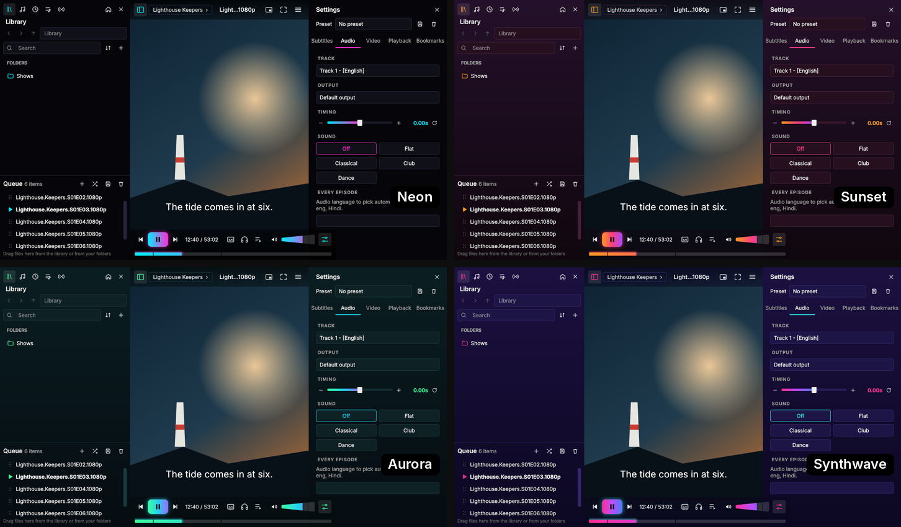
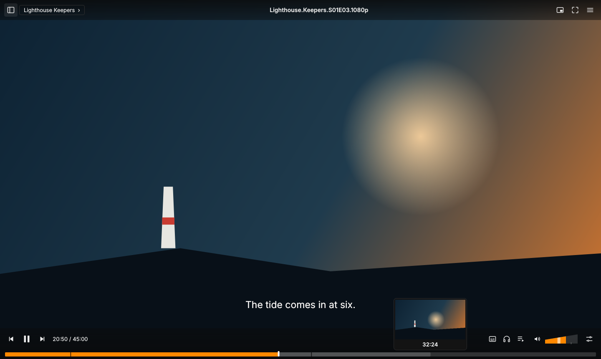
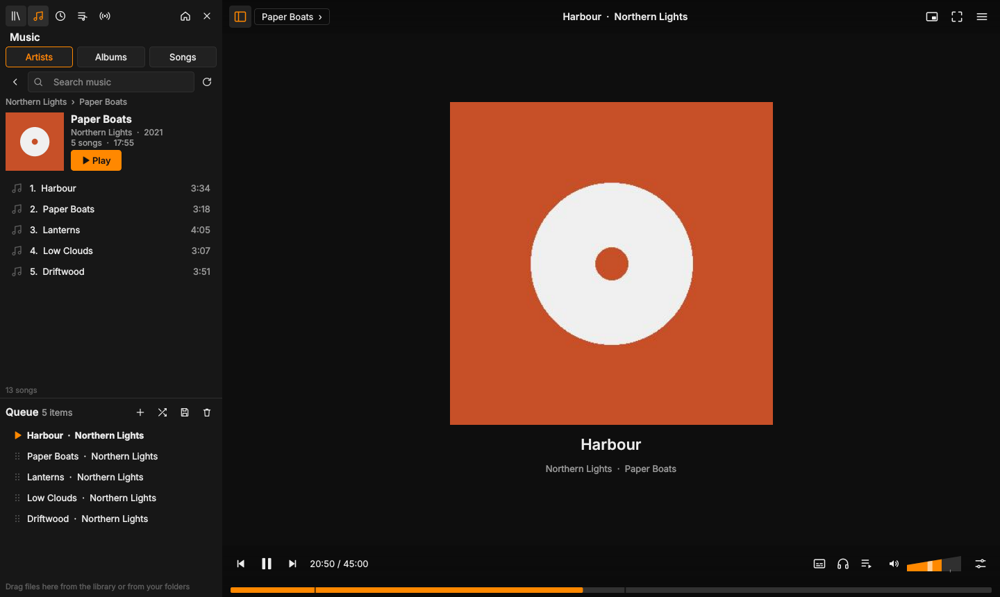

# Pylon

**A media player inspired by Juxtopposed's VLC redesign, grown into its own app.** Free and open source, for Windows, Linux and (experimentally) macOS. Pylon runs on VLC's engine, so it plays everything VLC plays, with a calmer interface and features of its own on top.

### [⬇ Download page: nirmaljosephukken.github.io/pylon-player](https://nirmaljosephukken.github.io/pylon-player/)

**Direct downloads:** [Windows](https://github.com/nirmaljosephukken/pylon-player/releases/latest/download/Pylon-Setup-1.6.1.exe) · [Linux](https://github.com/nirmaljosephukken/pylon-player/releases/latest/download/Pylon-1.6.1-x86_64.AppImage) · [macOS (experimental)](https://github.com/nirmaljosephukken/pylon-player/releases/latest/download/Pylon-1.6.1-macOS.zip) · [All releases](https://github.com/nirmaljosephukken/pylon-player/releases)
You also need [VLC](https://www.videolan.org/vlc/) installed. See [Install](#install).

**New to Pylon?** The [user guide](https://nirmaljosephukken.github.io/pylon-player/guide.html) shows every screen, panel and setting with pictures and step-by-step how-tos. It's also available as a [PDF](https://nirmaljosephukken.github.io/pylon-player/guide/Pylon-User-Guide.pdf).

**The story:** [700,000 people watched a VLC redesign. I built the player.](https://dev.to/nekku/700000-people-watched-a-vlc-redesign-i-built-the-player-1aio) · [Demo video](https://youtu.be/vCV3B_blLU0)

Pylon puts a new interface on top of libVLC, the engine inside VLC media player. VLC still does all the playback, decoding, subtitles and streaming, so Pylon plays everything VLC plays. The interface is built around the way people actually watch: quiet bars that get out of the way, a thick seek bar, subtitle timing you can see, per-show presets, and a library and queue you can reach without leaving the video.

> **Beta.** Tested on Windows 10/11 and Ubuntu; the macOS build hasn't been tried on a real Mac yet. Bug reports are very welcome.


## What's new

**1.6.1:** On Linux, picture in picture no longer turns the video black until Pylon is restarted. The top and bottom bars no longer get left behind while you drag the window: they hide until it stops moving, and pinned bars move with it.

**1.6.0:** DVDs: `.iso` images and `VIDEO_TS` folders play with their menus, which you use with the arrow keys and Enter, and Pylon picks up the title you were watching. A **waveform** in the seek bar for music (or videos too, in Preferences). **Repeat a part** with **L** (A–B), **step back a frame** with **Shift+E**, **cast to a Chromecast** from the menu, **Shuffle all** in Music, and new sort orders: music by Recently played and Most played, playlists by how much you've watched. Fixes: a folder saved as a playlist sorts by file name again, not by the titles from its tags, and full screen with Super Resolution no longer goes black (panels open in a window while it's on).

**1.5.1:** New episodes added to a playlist or the queue now slot in next to the others from the same show, in order, and the queue and playlists have **Sort by name**. When a key is already taken, the shortcuts window offers to move it to the action you're changing. **A** and **C** step through aspect ratios and crops. Songs no longer appear in Continue watching: the Music section on the home screen starts with **Continue listening**, which picks an album up from the song you were on. Full screen with Super Resolution gets another fix for the picture going black while a panel is open.

**1.5.0:** Save `.m3u` channel lists in the Streams tab: import a file or drop it on the list, and it shows how many channels it has. Lists can grow with more streams and be exported. Pin streams, playlists, artists and albums to the top of their tabs. Reorder or hide any home screen section in Preferences, and there's a new Music section. The Recent tab has a right-click menu (play, queue, add to playlist, remove from Recent), and the update download bar uses your accent colour. Find online keeps a fixed order with your preferred site starred, and Super Resolution redraws more reliably in full screen.

**1.4.0:** Fixes a startup crash on Fedora and other Linux systems using PipeWire. A broken stream no longer skips to the next one, and the queue keeps its place. The queue button now switches between Stop, Shuffle, In order and Loop. Search long queues, raise the maximum volume to 150% or 200% in Preferences, and open Preferences with Ctrl+,. Streams sort the right way round, and the subtitle timeline's offset label is no longer cut off.

**1.3.10:** Files dropped onto Pylon or opened with "Open with" now play in name order, so episodes stay in sequence. Saved streams can be renamed and their links copied, from the library and the queue. Double-click an equalizer slider to reset it. Find online offers several subtitle sites and searches by show or film name. With RTX Video Super Resolution on, the picture now redraws correctly after panels open or close and in full screen. The Linux AppImage no longer picks up the system's Qt add-ons, and its startup log records more detail for crash reports.

**1.3.9:** Zooming into the video now always fills the window with the right part of the picture. Picture in picture is borderless: drag the video to move it and drag an edge to resize it. On Windows, Preferences can turn on RTX Video Super Resolution for sharper upscaling on NVIDIA RTX and Intel graphics. On Mac, the top bar now sits flush with the top of the screen in full screen.

**1.3.8:** A custom 10-band equalizer with a preamp (saved, and remembered by per-show presets), plus a short description for every built-in preset. Zoom into the video with Ctrl+scroll or Ctrl+= / Ctrl+-, drag to look around, Ctrl+0 to reset. Ctrl+Shift+L shows or hides both side panels. Clicking the Library or Music tab you're already on takes you back to its start. Playlists and streams list the newest first. Changing sharpening while paused now keeps the same frame, and the sharpening slider moves in finer steps.

**1.3.7:** Fixes the Linux AppImage crashing at startup on newer distributions such as Fedora 44. Saved custom colours now stay after a restart, each sidebar can open on a tab you choose, folders can be added to the library from their right-click menu, and more sorting options (date modified, most items).

**1.3.6:** Configure video mouse buttons in Preferences > Controls, disable left double-click for immediate single clicks, keep the cursor visible in dialogs, and fix Linux AppImage compression compatibility.

**1.3.5:** Hide Continue watching, Recently played and home playlists independently, use optional simplified queue names, sort music/playlists/streams with visible result counts, and open the data folder from Privacy. Folder playlist names are suggested automatically, home cards have context menus, and neon colour swatches no longer crop. Includes the Mac VLC loader correction from the revised 1.3.4 Mac package.

**1.3.4:** Save folders and the queue to existing playlists without adding duplicate files. Collaboration artists appear separately when the library provides enough evidence, while album grouping stays intact.

**1.3.3:** Keep Preferences open while trying themes, save folders as playlists, search playlists and streams, click seek previews to jump to their recorded time, and use side panels without the playback bars covering them.

**1.3.2:** Smoother seeking: clicking or dragging the seek bar no longer makes the picture flicker. The release notes in the update window are readable again.

**1.3.1:** Pylon now tells you when a new version is out, and on Windows updates itself with one click (your library, presets and settings are kept). Playlists continue from the first item you haven't finished. Mark things as watched straight from Continue watching, or select several items in the queue and mark or remove them together. Shuffle is now an on/off switch: click again to get the original order back. Presets now restore Sharpen and apply picture settings like saturation reliably. The logo's play triangle is centred properly.

**1.3:** Themes. Dark, Pitch black, Warm grey and Midnight blue, a custom tint from any colour, and four **neon themes** (Neon, Sunset, Aurora, Synthwave) with gradient highlights and a soft glow. Preferences > General > Theme.



**1.2.1:** Polish from the first round of user feedback. A Sharpen slider, an option to keep the controls visible outside fullscreen, a new play button and a rounder volume cone, watch progress on the home page, cleaner titles, and a tidier settings panel.

**1.2:** Preview pictures on the seek bar, and a music library sorted by artist and album.





Full history on the [Releases](../../releases) page.

## Credit

The interface follows the **VLC redesign concept by [Juxtopposed](https://www.youtube.com/@juxtopposed)**:

* Video: [the VLC redesign walkthrough](https://www.youtube.com/watch?v=ERFeOgqk324)
* Design file: [VLC redesign on Figma Community](https://www.figma.com/community/file/1691465999134370980/vlc-redesign)
* Site: [juxtopposed.com](https://www.juxtopposed.com/)

That redesign was a design concept made in Figma, shared free on Figma Community under the [Creative Commons Attribution 4.0 licence (CC BY 4.0)](https://creativecommons.org/licenses/by/4.0/). Pylon is an independent, adapted implementation of many of its ideas, rebuilt in code with changes and additions. No files or artwork from the Figma file are included in this repository. Juxtopposed isn't involved in Pylon, doesn't endorse it, and isn't responsible for its bugs.

Pylon is **not affiliated with, sponsored or endorsed by VideoLAN**. VLC and the VLC cone logo are trademarks of VideoLAN. If you like VLC, consider [donating to VideoLAN](https://www.videolan.org/contribute.html).

## Install

Pylon plays everything through **VLC**, which you install yourself (Pylon never includes it). Then grab the Pylon download for your system from [Releases](../../releases).

| | Windows 10 / 11 (64-bit) | Linux (x86-64) | macOS 14+ (experimental) |
| --- | --- | --- | --- |
| **1. VLC** | [VLC 64-bit installer](https://www.videolan.org/vlc/download-windows.html) | `sudo apt install vlc` (Ubuntu, Debian, Mint), `sudo dnf install vlc` (Fedora, from RPM Fusion), `sudo pacman -S vlc` (Arch) | [VLC for macOS](https://www.videolan.org/vlc/download-macosx.html), dragged into Applications |
| **2. Pylon** | `Pylon-Setup-1.6.1.exe` | `Pylon-1.6.1-x86_64.AppImage` | `Pylon-1.6.1-macOS.zip` |
| **3. Run** | Run the setup. No admin rights needed. | `chmod +x Pylon-*.AppImage`, then double-click it | Unzip, move **Pylon** to Applications, see the first-launch note below |

Nothing else is needed: each download carries its own Python and Qt.

**Windows.** Setup installs Pylon for your account only, adds Start menu and desktop shortcuts, and lists Pylon under "Open with". Remove it from **Settings > Apps**. Your library and history stay in `%APPDATA%\Pylon` unless you delete that folder.

**Linux.** Needs glibc 2.34 or newer (Ubuntu 22.04+, Debian 12+, Fedora 35+). The first launch adds Pylon to your applications menu and "Open with". On Wayland it runs through XWayland, because VLC draws video into an X11 window. The **Flatpak and Snap versions of VLC can't be used** by other apps, so install VLC from your distribution's packages.

**macOS (experimental).** It hasn't been tested on a real Mac yet: reports are very welcome. Pylon isn't signed by Apple, so the first launch is blocked. Open **System Settings > Privacy & Security**, scroll down and click **Open Anyway** next to Pylon, then confirm. Pylon works on Apple Silicon and Intel Macs.

### "Windows protected your PC"

Pylon's installer and `Pylon.exe` aren't code-signed yet, so Windows SmartScreen may warn you the first time. Click **More info**, then **Run anyway**.

### Make Pylon your default player (Windows)

Setup lists Pylon for 34 video and audio types. Windows doesn't let apps make themselves the default, so the last click is yours:

* right-click a video, choose **Open with**, then **Choose another app**, pick **Pylon** and click **Always**, or
* open **Settings > Apps > Default apps**, type a file type such as `.mkv` in the top box, click the current app and choose Pylon.

Opening another file while Pylon is running plays it in the same window.

### VLC somewhere unusual?

Pylon looks in the usual install places, and in a `VLC` folder inside, next to or a few folders above Pylon's own folder (so `E:\Apps\Pylon\…` finds `E:\Apps\VLC`). If it still says it can't find VLC (a portable VLC, say), click **Locate VLC folder…** in that message, or use **Preferences > Performance > Use VLC from a folder…**. Pylon starts using it right away.

### Run from source instead

Windows: install 64-bit Python 3.10+, then double-click `setup.bat` in a clone of this repo. Any OS: `pip install -r requirements.txt`, then `python main.py`. How the downloads are built is described in [`packaging/`](packaging/).

## Features

| | |
| --- | --- |
| **Quiet bars** | Top and bottom bars float over the video, appear when you move the mouse, and vanish when you stop. They work in fullscreen too, so the title is always one hover away. `H` hides everything. Prefer them always on screen? **Preferences > Interface > Keep the controls visible**. |
| **Controls** | Play on the left with previous and next around it. Fullscreen and picture-in-picture at top right. One menu button instead of a duplicate menu bar. |
| **Thick seek bar** | Along the bottom edge, with bookmark ticks and chapter marks. Hover to see a **preview picture** of that moment. Previews are made in the background the first time you play a video and kept for next time. For music the bar can show a **waveform** of the song (videos too, if you like: Preferences > Interface). |
| **Repeat a part** | Press `L` at the start and `L` at the end of a part, and it plays again and again until you press `L` once more. Also in the Playback tab and the right-click menu. |
| **DVDs** | Open a DVD image (`.iso`) or a copied DVD folder (`VIDEO_TS`) and it starts at the disc's menu: arrow keys to choose, Enter to play. Titles, arrow buttons and Disc menu are in the Playback tab. Pylon remembers the title and time you stopped at. |
| **Cast** | Menu > Cast to sends the video to a Chromecast on your network, from the point you were at. |
| **Cone volume** | A volume control shaped like a cone. Click, drag or scroll. Goes to 125%, or to 150% or 200% if you raise the limit in Preferences > Playback. |
| **Subtitle and audio buttons** | Bottom right. Audio also lists output devices (speakers, headphones). |
| **Queue** | A real queue. Drag files in from the library or from Explorer, and reorder by dragging. Playing a file queues the rest of its folder, so the next episode just plays. Select several items (`Ctrl` or `Shift` click) and right-click to mark them watched or remove them, or press `Delete`. The **queue mode** button cycles through Stop (grey: stop when the item ends), Shuffle, In order and Loop (play the item again). Leaving Shuffle puts the original order back. Choose the starting mode in Preferences. |
| **Settings sidebar** | `Ctrl+T`. Subtitles, Audio, Video, Playback and Bookmarks tabs, without a dialog covering the video. |
| **Subtitle timeline** | See where subtitle lines fall around the playhead and drag them until they line up with the speech. Sliders and the `G` / `J` keys also work. |
| **Subtitle look** | Relative or exact pixel size, font, color, outline, background and position. |
| **Per-show presets** | Save timing, look, tracks, speed and filters once. Every file in that folder gets them automatically. |
| **Default tracks** | Pick a subtitle or audio language to switch to on every episode. |
| **Add subtitles in bulk** | To this file, a whole folder or the whole queue. Files are matched by name or episode number (S01E02, 1x02, E02), you can fix any pairing, and pairings are remembered. "Search online" opens OpenSubtitles. |
| **Picture and sound presets** | Vivid, Bright, Cinema, Soft, Mono, plus sliders and **Sharpen**. VLC's equalizer presets as one-click chips. Rotate, flip, crop, zoom and aspect ratio. |
| **Playback** | Speed, sleep timer (including "end of this file"), queue mode, starting the queue again at the end, and media info. |
| **Music** | Songs from your library folders, sorted by **artist, album and song**, with cover art from the files. Open an album and press Play, or double-click any song. **Shuffle all** plays everything in the view in a random order, and you can sort by Recently played or Most played. |
| **Library** | Opens from the folder name in the top bar without leaving the video. Back, forward, up, address bar, search, sorting (including unwatched first), pins, recent files, playlists and streams. |
| **Continue watching** | A home page with what you were watching and how far you got, plus a "Continue from 12:34" button next to the play controls. Hover a card and click ✓✓ to mark it as watched. Music has its own **Continue listening** row that resumes an album from the song you were on. Playlists show how many items you've watched and pick up from the first one you haven't finished. |
| **Streams** | Paste a link or a channel list (`.m3u`) and it becomes a queue of channels. Import `.m3u` files (or drop them on the Streams tab) to keep them as channel lists, with a channel count, more streams added later, and export. Pin favourites to the top. |
| **Bookmarks** | `Ctrl+B` adds one instantly. A list with chapters in the sidebar. |
| **Shortcut hints** | On-screen messages show which key you pressed. Every shortcut can be changed (`F1`). |
| **Themes** | Dark, Pitch black, Warm grey, Midnight blue, a custom tint from any colour, and **neon** themes (Neon, Sunset, Aurora, Synthwave) with glowing gradient highlights. Preferences > General. |
| **Updates** | Pylon checks once a day whether a new version is out. On Windows, **Update now** downloads and runs the installer for you; on Linux and macOS it opens the download page. Menu > Check for updates. |
| **Preferences in plain words** | Accent color, auto-hide delay, resume behaviour, subtitle auto-detection. Each has an info icon. |


## Keyboard

| Key | Action |
| --- | --- |
| Space | Play / pause |
| Left / Right | Jump 10 s (with Ctrl: 1 min) |
| Up / Down | Volume |
| M | Mute |
| F or Enter | Fullscreen |
| Esc | Leave fullscreen or picture-in-picture |
| Ctrl+P | Picture-in-picture |
| H | Hide the interface |
| N / P | Next / previous |
| [ ] = | Slower, faster, normal speed |
| G / J | Subtitles earlier / later (50 ms) |
| Shift+K / K | Audio earlier / later |
| V / B | Next subtitle / audio track |
| A / C | Next aspect ratio / crop |
| Ctrl+B | Bookmark |
| Ctrl+L / Ctrl+T / Ctrl+Q | Library, settings sidebar, queue |
| Ctrl+Shift+L | Show or hide both side panels |
| Ctrl+scroll, Ctrl+= / Ctrl+- | Zoom into the video (drag to look around) |
| Ctrl+0 | Reset zoom |
| Ctrl+O / Ctrl+F / Ctrl+N | Open file, folder, stream |
| E / Shift+E | Next / previous frame |
| L | Repeat a part: set start, set end, off |
| Shift+S | Snapshot (saved to `Pictures\Pylon`) |
| F1 | All shortcuts (changeable) |

Mouse: click the video to play or pause, double-click for fullscreen, scroll for volume, right-click for the menu.

## Good to know

* **Pylon is just a player.** It doesn't include, host or link to any films, shows, music or streams. Only play things you have the right to play.
* **Your data stays on your computer.** History, resume points, presets, bookmarks and subtitle pairings are stored in `data.json` in `%APPDATA%\Pylon` (Windows), `~/.local/share/pylon` (Linux) or `~/Library/Application Support/Pylon` (macOS). The only time Pylon goes online by itself is a once-a-day update check: an anonymous request to GitHub for the list of Pylon releases. When you open the Cast menu, Pylon looks for Chromecasts on your local network. Nothing about you or your files is sent, and you can turn it off in Preferences > Privacy.
* **VLC location.** Pylon finds a normally installed VLC by itself. For a portable VLC use **Locate VLC folder…** (no restart needed), put it in a `VLC` folder next to Pylon, or set the `PYLON_VLC_DIR` environment variable.
* **Some changes restart the video.** Changing the subtitle look or rotating restarts the video at the same spot, because VLC reads those settings when its engine starts.
* **Seek previews** work for video files on your computer (not online streams). Turn them off in **Preferences > Interface** if you prefer.
* **Not built yet** (from the original concept): reverse playback and a drag-and-drop layout editor.
* **DVDs** play from `.iso` images and copied `VIDEO_TS` folders. Encrypted discs in a drive and Blu-ray menus depend on what your VLC supports.

## Reporting a bug

1. Note what you did and what happened.
2. Find Pylon's `error.log` and `vlc.log`, in a `logs` folder: next to Pylon on Windows (`%LOCALAPPDATA%\Programs\Pylon\logs` for an installed copy), `~/.local/share/pylon/logs` on Linux, `~/Library/Application Support/Pylon/logs` on macOS.
3. On Windows you can also run **`diag.bat`** in the Pylon folder. It plays your last file straight through the VLC engine and writes `logs\diag.txt`.
4. Open an issue and attach the logs. **Check them first**: they contain your file names and folder paths.

## Project layout

```
main.py              entry point
app/                 the application: engine.py (VLC), window*.py (main window, menus, playback),
                     library*.py (library, music, queue), sidebar.py, dialogs.py, waveform.py, thumbs.py
launcher/            source for Pylon.exe (the small Windows launcher)
packaging/           how the Windows installer, Linux AppImage and macOS app are built
setup.bat            run-from-source setup on Windows
register_pylon.bat   register a source checkout with Windows "Open with"
diag.bat, diag.py    playback diagnostics
```

## Licence

Pylon's code is under the [MIT licence](LICENSE). It uses libVLC (LGPL 2.1+), python-vlc (LGPL 2.1+) and Qt for Python (LGPL v3), none of which are included in this repo. See [THIRD_PARTY_NOTICES.md](THIRD_PARTY_NOTICES.md).
